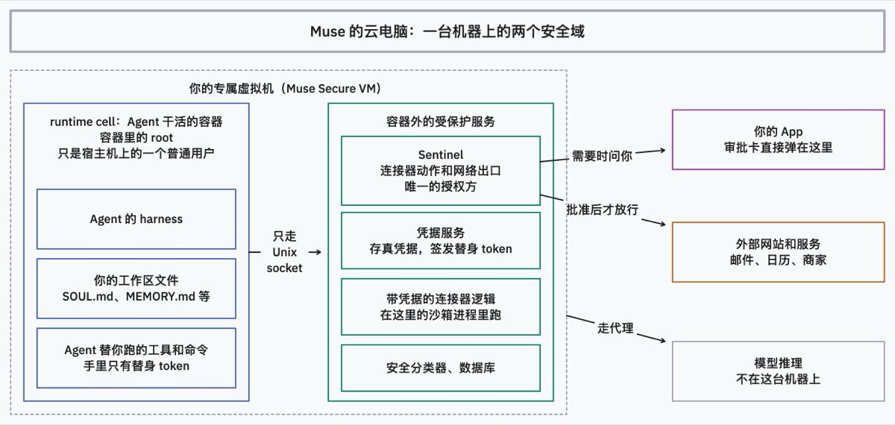
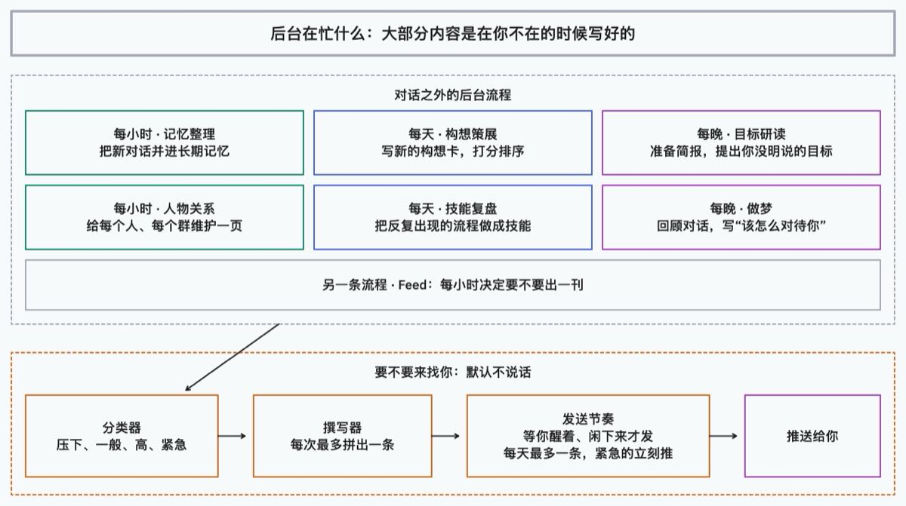
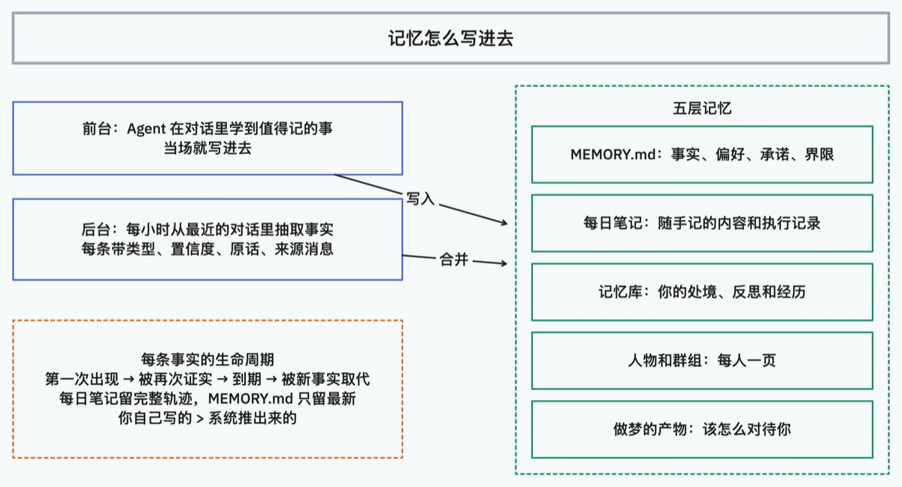
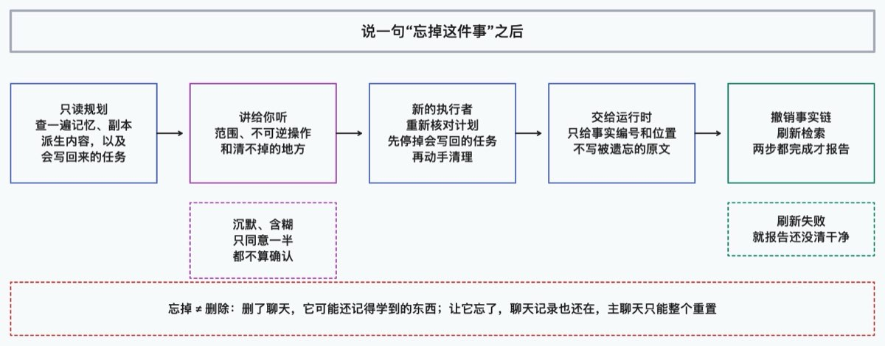
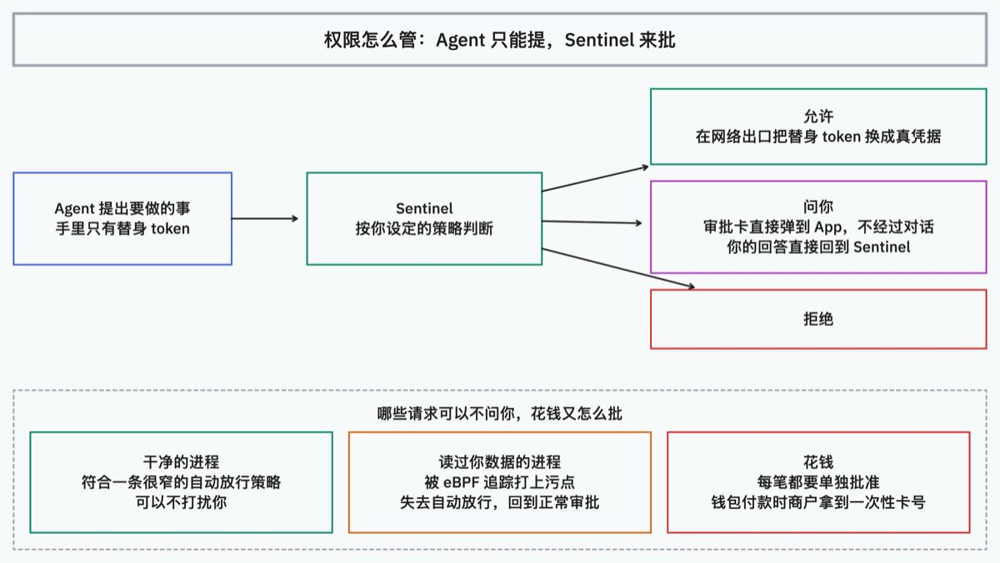
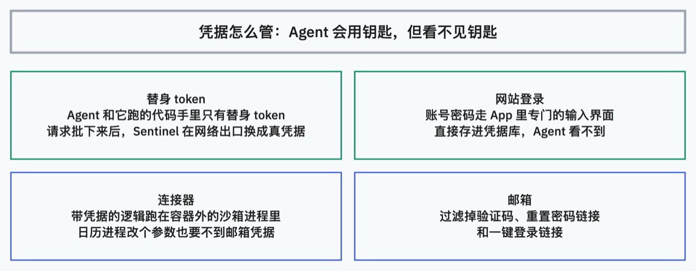
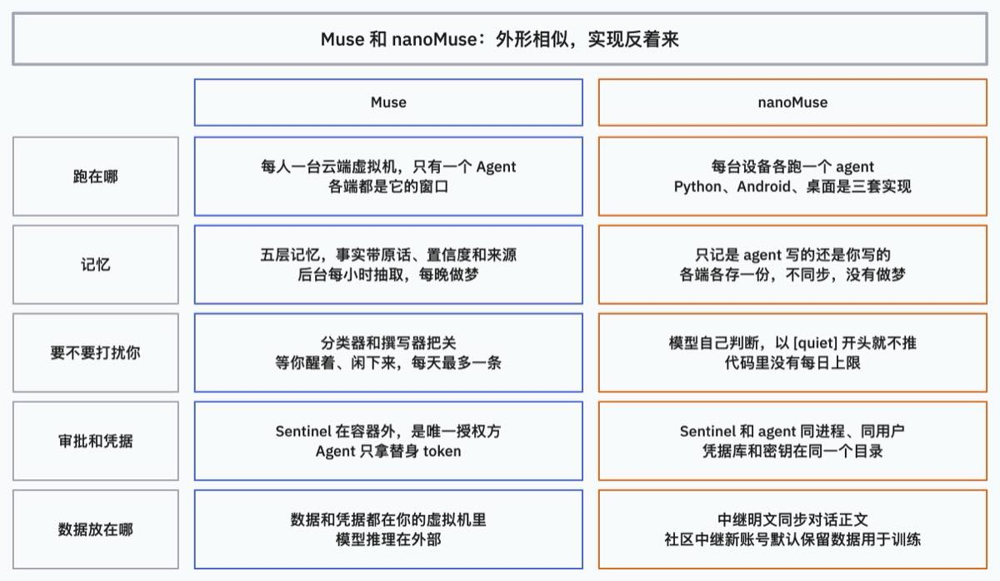

提到 Personal Agent，很多人的第一反应是找个 Agent 替自己干活。可同样是 Personal Agent，大家拿 Grok Bot 和 Muse 干的活，几乎没什么重叠。

Grok Bot 常见的用法，是按岗位搭几个 Bot 一起干活：盯着 Slack 和 GitHub 的消息，跟进销售线索和会议，整理营销报表，运营社交媒体等等。而 Muse 不一样，更多的人拿它来办生活里的杂事：打电话替自己排队等人工，在客服窗口里把网费砍下来，翻银行账单揪出一笔不认识的扣款，再顺手退掉忘了的订阅等等。

一个接管了上班琐事，一个接管了日常琐事。这不只是用法不同，两个产品的设计骨架和生态天然造就了它们的不同用法。Grok Bot 按岗位给你一群 Bot，每个 Bot 各管各的记忆和定时任务；Muse 只给你一个 Agent，一条主对话从第一天一直聊下去，你生活里的人和事都记在同一个 Agent 身上。

设计骨架不一样，记忆和权限自然也是两种管法。[上一篇拆完了 Grok Bot](https://mp.weixin.qq.com/s/NTnsKkc3BRM-Q6S-eIkXGA)，这一篇再看看让 Meta 重新崛起的 Muse，这样一个替你过日子的 Personal Agent，背后是怎么工作的。

## Muse 提供了什么环境

Muse 是 Meta 上个月推出的 Personal Agent，官方定位是一个人人都能用的个人 Agent，会主动帮你推进目标、给你出主意，用起来就像给人发消息，App 和 WhatsApp 里都能聊。目前只在美国和加拿大开放。

和 Grok Bot 最大的不同，是一个人只有一个 Agent，没有 Bot 名册，也没有群聊。它的名字、头像和性格由你来定，主对话从第一天一直延续下去，话题多了可以另开副聊天，对话上下文分开，记忆还是同一份。

用过 OpenClaw 的人，看到它云电脑里的文件会很眼熟：SOUL.md、IDENTITY.md、USER.md、MEMORY.md、AGENTS.md、HEARTBEAT.md，一个不差。这也是 X 上流传最广的说法，Muse 就是给普通人用的 OpenClaw。Meta 那边也没否认，说代码是从零写的，但产品上深受 OpenClaw 启发，文件名也是照着用的。

不同的是，在 OpenClaw 里这些文件要你自己写、自己清理；在 Muse 里，MEMORY.md、SOUL.md 这几个你可以在 Identity 页直接改，但大部分时候不用动手，后台会替你整理。

配置上，两边也差了不少。Grok Bot 是 8 核 CPU、15GB 内存的 Debian 13；Muse 则只有 2 个 vCPU、8GB 内存。Grok Bot 会给每个 Bot 都开一个桌面和浏览器，Muse 的 Agent 则没有桌面。

官方的说法是，这是一台机器上的两个隔离的安全域，而不是一个拿着 root 权限的 Agent。上一篇讲过，Grok Bot 的凭据以环境变量的形式出现在 Shell 命令上，靠审查模型在动手前把关；Muse 则直接把凭据和对外的出口放到了 Agent 够不着的地方。

## Muse 是怎么运行的

对话之外，Muse 一直有一组后台流程在不停跑着：每小时整理记忆、更新你身边每个人的档案，每天写构想卡、复盘技能，每晚研读你的目标，再“做梦”回顾最近的对话。Feed 则由另一条流程每小时决定要不要出一刊。

跟 Codex 这种编程 Agent 不同，Muse 后台执行的任务虽然非常多，但来找你的次数并不多。普通的事要等你醒着、闲下来才发，每天最多一条，只有紧急的才立刻推送；每条结果还要先过分类器和撰写器两关，提示词里写得很明白：没有值得说的，就一条都不发。嫌它太吵或者太安静，直接跟它说就行：

构想卡也有一套规矩。每张卡都是一份可以验收的执行合约，写着做完你能得到什么、有哪些限制、怎么算做好、为什么推给你；写完还要过一道评审，只问一个问题：这张卡是不是只可能写给这个人？你问它为什么推这张，它也得去数据库里查当初存下的理由，不能临场编一个。

目标页也是同一个思路。目标本身不跑任何东西，真正干活的是挂在它下面的定时任务。

上一篇讲过，Grok Bot 的主动性是在聊天里提一句，问你要不要把重复的活做成定时任务；Muse 则把主动性拆成了几个单独的页面和一整套后台流程。

## 记忆怎么管

跟所有 Agent 一样，会话聊久了总是需要压缩，而压缩就不可避免导致信息丢失，所以 Muse 在对话之外另外维护了一套五层的记忆。写入有两条路：Agent 在对话里学到值得记的事，当场就写进去；后台每小时从对话里抽出一条条事实，带着类型、置信度、你的原话和来源消息，再合并进去：

这些事实会被证实、到期、被新的事实取代，MEMORY.md 只留最新的版本，旧的轨迹留在每日笔记里。之前我写 [OpenClaw 的正确打开方式](https://mp.weixin.qq.com/s/AihoveTaONbtSt4ez87B2w) 时提过一个坑：OpenClaw 的 Dreaming 容易把啰嗦的内容也晋升上来，MEMORY.md 越来越臃肿，只能定期手动清理。Muse 用新事实取代旧事实的办法来控制它，做梦写出的那份“该怎么对待这位用户”的总结，也只当作参考，不能替你下命令。

当然只是增加记忆还远远不够，能够正确遗忘才是记忆系统的核心。在 Muse 里，你说一句“忘掉这件事”，它并不是简单地删掉一行记忆，而是会走一整套清理流程，具体步骤如下图所示：

另外，遗忘和删除在 Muse 里是分开的。删掉聊天记录，它从里面学到的东西可能还留在记忆里，需要再让它忘掉一次；反过来，让它忘掉某件事，原来的聊天记录也还在，而主聊天只能通过重置整个 Muse 才能清空。

## 权限是怎么管理的

打电话、砍网费、下单，这些都是让 Agent 替你出面去做事，而 Agent 总是有可能会出错的。Meta 官方文档也强调了这个安全问题：不管模型多强，这类 Agent 都一定会犯错，也会被它读到的数据攻击，所以整套系统都是按照 Agent 可能已经被攻破的前提来设计的。

这套设计的核心是 Sentinel。它是一个跑在容器外面的独立服务，也是连接器动作和网络出口唯一的授权方：Agent 只能提出要做什么，批不批则由 Sentinel 按照你设定的策略来决定。需要问你的时候，审批卡会直接弹到 App 上，而不是通过你和 Muse 的对话，所以 Agent 既看不到这张卡，也没法替你点同意：

哪些出站请求可以不打扰你？Muse 的办法是在内核里用 eBPF 追踪数据的流向：每个工具进程启动时都是干净的，一旦读过你的数据，就会被打上污点，从而失去自动放行的资格，必须走正常的审批流程。而涉及花钱的操作，每一笔都需要你单独批准。

凭据也是同样的思路，Agent 可以使用凭据，但始终看不到凭据本身：

上一篇讲权限时我提到，Grok Bot 能守住的约束基本都写在了 schema 和代码里。Muse 则把这条线又往下推了一层，把约束放进了 Agent 碰不到的另一个安全域，这样即使 Agent 被骗了，也没法绕过 Sentinel 把你的数据发出去。当然，官方也承认 prompt 注入目前仍然没有解决，所以同时开放了漏洞赏金计划。

定时任务的设计也和 Grok Bot 不太一样。任务跑完之后，要先判断有没有值得报告的内容，再交给面向你的 Agent 转告，所以任务跑完并不等于你收到了结果，官方条款里也写明了不保证按时完成。需要频繁盯着某件事时，Muse 也不会每分钟叫醒一次模型，而是让一段脚本去轮询，真有事了才叫醒模型。

不过，这些设计也是有代价的：Muse 的能力基本依赖 Meta 和合作方提供的技能和连接器，用户没法自己接入 MCP 服务器。

## 浙大团队的 nanoMuse

Muse 目前只在美国和加拿大开放，国内想体验的话，可以试试浙大团队做的开源项目 nanoMuse。它在 Muse 上线两周后开工，基本由一个人开发，两周多就发布了 1.0，GitHub 上已经有近千个 star。

从使用体验上看，nanoMuse 基本上就是 Muse 的复刻（对得起它的名字）：Feed、Ideas、Goals、Library、Markdown 记忆和审批卡片等等都有，还多了操作 Android 手机屏幕、设备之间互相派活这些 Muse 没有的能力。不过从代码来看，它的实现跟 Muse 差别很大：

其中差别最大的是 Sentinel。nanoMuse 的 Sentinel 和 agent 跑在同一个进程、同一个系统用户下，凭据库和密钥也放在同一个目录里，作者也承认，这只是策略边界，而不是权限边界。1.0 发布前后，它就已经修过两次同一类漏洞：在放手模式下，后台任务可以先读取一份私密数据，再悄悄发到一个陌生的主机上，整个过程都不需要审批。

所以 nanoMuse 更适合用来体验 Muse 这一套交互方式，真正难做的是交互背后的两件事：后台怎么把记忆积累起来、管理好，以及怎么把对外的出口放到 Agent 够不着的地方。

## 写在最后

拆完 Muse 再回头看，它和 Grok Bot 其实是在同一道题上给出了两个不同的答案。Grok Bot 给你一群 Bot 和一台什么都能装的电脑，用起来很灵活，但很多边界需要你自己操心；Muse 只给你一个 Agent，记忆交给后台整理，出口放在 Agent 够不着的地方，普通人也敢把事情交给它。所以挑 Personal Agent 之前，先想清楚你要它接管的是上班琐事，还是日常琐事。

不过，越懂你的 Agent，记住的东西也就越多。Muse 会给你提到的每个人建档，让它忘掉也不等于真的清理干净了，Meta 自己也承认现在的架构挡不住它访问你的数据。所以除了看它能替你办成多少事之外，也要注意它的隐私问题，比如记了谁、记了什么，以及能不能在需要的时候让它真的忘掉。

推荐阅读：

- [拆开 Grok Bot，看看一个 Personal Agent 是怎么工作的](https://mp.weixin.qq.com/s/NTnsKkc3BRM-Q6S-eIkXGA)
- [OpenClaw 的正确打开方式：从也就那样到离不开](https://mp.weixin.qq.com/s/AihoveTaONbtSt4ez87B2w)
