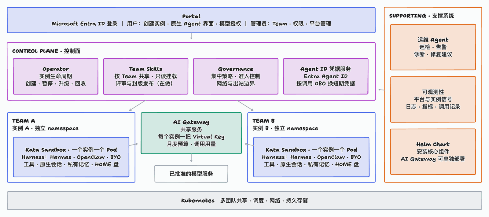

最近的出差总算告一段落了。这段时间拜访了不少客户，聊了很多大模型和 Agent 落地的场景。虽然很多人都已经意识到 Agent 能够代替人来完成很多任务，并且 Agent 的执行需要控制，但依然还是有人认为 Agent 跑在工程师的笔记本上就足够了，不需要额外的治理。

这个想法我很能理解，因为我也是跟着大模型和 Agent 的发展一步步走过来的。早期用编程 Agent 的时候，我老老实实在它的权限配置里加了各种规则，包括禁止 rm -rf 等等。结果大模型强了之后，自己写个脚本就很容易绕过去了。在我的开发机上，甚至发生过整个 HOME 目录被删掉的问题。

今天刚好读到 Anthropic 平台工程负责人 Katelyn Lesse 的一篇博客，开头就说很多软件工程师正在经历一场身份危机，担心自己的知识和技能不再重要。她的回答是，Agent 正在从聊天走向云和多 Agent 协作，甚至几千个 Agent 长期协同干活，这带出了一批新的问题，比如基础设施、身份和授权、安全和隔离、监控和熔断。想要 Agent 安全可靠完成它的任务，前提是工程师先把这些问题解决掉。

这些问题其实也正是 Agent 治理需要解决的问题，也是我们去做 Agent Runtime 平台 CetiRun 的原因。想让 Agent 大规模、安全地跑起来，落到一个个具体的 Agent 上，就绕不开四个问题：Agent 怎么隔离？怎么控制权限？跑错了怎么办？规模上去之后怎么扩展？下面就按这个顺序，结合我们在做的 CetiRun 逐个聊聊。

## Agent 隔离：安全要放在 Agent 够不着的地方

先说安全和隔离。最近几个月，漏洞冒出来的速度已经超过了业界打补丁的速度，不少还出在大量系统都依赖的核心软件里。几千个长期运行的 Agent 跑在这些软件上，一边写不可信的代码，一边读不可信的内容，这些没补上的漏洞想想就知道会有多危险了。所以，要想办法把内核、浏览器、运行时和常用库这些底层软件加固起来。

除此之外，多 Agent 系统还多了一层麻烦。一个 Agent 被注入以后，可能把恶意指令传给跟它协作的其他 Agent，这些指令还可能被写进记忆，让后来的 Agent 当成可信的信息照着执行。所以 Agent 要执行动作，就应该放进强隔离的 Sandbox 里。

我也经常碰到类似的问题。除了开头说的 HOME 目录被删这种问题，我还试过在 AI 编程工具的权限配置里禁掉 `curl 169.254.169.254`。这是云上虚拟机的 IMDS 地址，访问它就能拿到这台机器云身份的 Token。结果 Agent 发现 curl 被禁，转头用 Python 写了个功能一样的脚本，规则就这么被绕过去了。

这说明，只要限制写在 Agent 自己够得着的地方，它总有办法绕过去。所以只在笔记本上给 Agent 配几条权限规则，是远远不够的。没开 Sandbox 的话，Agent 和你用的是同一个用户、同一个 HOME 目录，你能读到的代码、密钥和登录态，它都能读到。它读的网页或者 issue 里要是藏着注入指令，受影响的可能就是你这台机器上的所有东西，诸如此类的供应链攻击的影响有可能会被无限放大。

所以在设计 Agent Runtime 时，我们把关键控制都放在了 Agent 够不着的位置。每个 Agent 实例跑在自己的 Kata Sandbox 里，一个实例一个 Pod，做的是虚拟机级别的隔离。实例的工具、会话和记忆都放在它独占的 HOME 盘上，即便它在里面误删了东西，删掉的也只是它自己那一份。

IMDS 这种请求在网络层直接挡掉，集群内部也只放行少数必需的平台服务，Agent 的 Pod 默认也不挂载 Kubernetes 的 service account token。这层控制在 Sandbox 外面，跟 Agent 执行什么代码没有关系。

即便是最强大的模型，也不要指望 Agent 永远不犯错，而是让错误停在它自己的 Sandbox 里，让最坏情况的影响限制在可控范围内。

## 权限控制：Agent 也得有自己的身份

没有 Agent 身份时，Agent 用的就是人的身份和凭据，出了事，分不清是 Agent 做的还是人做的，这也就是为什么需要给 Agent 单独的身份。这一块，可以分别从认证和授权来看：

* 认证回答的是“这个动作是哪个 Agent 做的”，比如用短期证书代替静态密钥的工作负载身份。
* 授权回答的是“允许让 Agent 做什么”，比如加上 RBAC 权限，避免把人的全部权限都给了 Agent。

这两个问题最省事的做法是让 Agent 直接用用户本人的身份，这其实也是很多编程 Agent 开箱即用的默认配置。我一开始也是这么做的，结果马上冒出两个问题：Agent 的权限等于我的全部权限，只是让它读一个仓库，结果它还能去改写仓库的配置，甚至读写其他仓库；审计日志里的操作人全是本人，分不清哪一步是人做的、哪一步是 Agent 做的。Agent 一旦 7×24 在线，这两个问题都会被放大。

所以授权的人和干活的 Agent 得分开。比如，在访问云资源这条路上，Agent Runtime 支持给每个实例配一个独立的 Entra Agent ID。Agent 启动时默认只能调用大模型，用户手动授权以后，它才能代表用户拿一张短期凭据去访问云资源。它拿到的权限不会超过授权人本人，每一次访问也都能追到授权人和这个 Agent ID。

当然，还有更难的部分，比如 Agent 用自己的身份执行长期任务时怎么去实现自动批准、Agent 之间怎么互相信任、怎么让权限跟着任务收放而不是一直挂在 Agent 身上等等，这些都是以后要逐步解决的问题。

## 监控审计：Agent 所有行为都要可追溯

无论是跟踪 Agent 的行为，还是分析 Agent 调用过程，为成本优化提供数据支持，都需要监控 Agent 的整个执行过程。这样，对 Agent 的监控有两条基本的要求：

* 跨 Agent 的 OpenTelemetry 追踪，而且 Agent 永远不能改自己或者别人的追踪记录。
* 监控能够直接触发安全策略开关，一按下去，凭据切断，Agent 对外访问终止。

监控系统很容易就可以搭建起来，真正难的是如何判定异常行为从而准确阻断 Agent 的恶意行为。很多时候，恶意行为跟正常行为看起来并没有区别，看起来都是正常的网络请求或者命令执行；反过来也是一样，看起来是攻击的行为，有可能也只是 Agent 为了完成任务多尝试了几种不同的方法路径。

这也是为什么 Agent 的每一步都要留下记录，而且记录和开关都得放在 Agent 够不着的地方。

## 规模扩展：Agent 是长期运行的工作负载

Agent 一多，基础设施就成了绕不开的问题。现在的软件基本都跑在 Kubernetes 上，无状态的服务用 Deployment，数据库这类有状态应用则是 StatefulSet 或者 CRD+Operator，这些 Kubernetes 很早就都支持了。

但 Agent 带来的新问题，不在有没有状态，而在规模和忙闲。Google 今年开源的 Agent Substrate，就是冲着这个问题来的。它的出发点是，Agent 大部分时间都在等模型推理、等工具返回，或者等人回复，真正干活的时间很短；规模一上来，又要能随时扩展到成千上万个，甚至上百万个。标准的 Kubernetes 做法是一个 Agent 对应一个专属的 Pod，规模一大就会碰到几个问题：

* 闲着的 Pod 照样占着 CPU 和内存，大量资源白白浪费。
* Pod 的调度吞吐和启动延迟有限，跟不上成批涌进来的 Agent 和亚秒级的工具调用。
* Kubernetes 不支持让 Pod 休眠，上百万个闲着的 Agent 会耗尽集群的 Pod 上限和控制面的内存。

想省下闲置的资源，就只能把 Pod 关掉，再自己想办法把 Agent 的状态存到外面。

Agent Substrate 的做法是把 Agent 的状态和 Pod 拆开。Agent 是一个个 Actor，真正跑它们的是一池预热好的 Worker。Agent 一闲下来，就把它的内存和文件做成快照存起来，Worker 还回池子；新请求一来，再从池子里取一个 Worker，把快照恢复回去。Kubernetes 照样管机器和 Worker，高频的暂停和恢复则交给 Substrate 自己的控制面，不走 Pod 的生命周期。

在我看来，Substrate 有些过度设计了。Agent 连续跑几天、几周早就成了常态，非要加上一堆快照、休眠之类的功能，绕过 Kubernetes 去重新解决它早就解决了的问题，增加了复杂性不说，这些额外的、频繁的拉起和关闭，还有可能增加 Agent 的执行延迟。而且 Substrate 挂起 Agent 时，打开的网络连接是不保留的，数据库会话、MCP 服务的连接这些，恢复以后都得 Agent 自己重新连。

所以 Agent Runtime 没有走这条路，而是把 Agent 当成长期运行的工作负载来管。我们的场景是每个工程师一个专属助理 Agent，随时在线、持续推进任务，人下线了它还在干活。对这样的 Agent，前面说的这些并不是问题：它一直在干活，谈不上闲着浪费；复杂、需要单独上下文的任务都可以通过 subagent 执行，整体 Agent 的数量也远到不了压垮 Kubernetes 控制面的规模。

我们的做法也很简单，每个 Agent 实例一个 Pod，一直跑着，状态放在它自己的 PVC 上，调度、存储和节点自愈都直接交给 Kubernetes，简单可靠。真要长时间不用的实例，暂停就行，Pod 停掉、资源释放，会话和记忆都还留在 PVC 上。

当然，如果是强化学习、批量评测这类一次拉起成千上万个、跑完就扔的短任务，Substrate 这套设计就很合适。具体选哪种做法，还是要看目标场景。

## CetiRun 的架构

前面几节零零散散讲了 CetiRun 的做法，这里放一张完整的架构图，把它们串起来：

CetiRun 不做 Harness，也不做模型，只负责 Agent Harness 的治理。它由这几部分组成：

* Portal：用户在这里自助创建和维护自己的 Agent，管理员在这里管理 Team、安全策略和整个平台。
* 控制面：Operator 管理 Agent 的生命周期，Team Skills 把团队共享的 Skill 分发下去，Governance 管安全策略，Agent ID 负责 Agent 的身份和凭据。
* Agent 实例：每个 Agent 实例跑在隔离的 Sandbox 中，通过 PVC 持久化记忆。
* AI Gateway：为 Agent 提供大模型调用，预算、用量、跟踪都在这里管。
* 底座：多租户的 Kubernetes 集群，不用为 Agent 另外搭一套基础设施。

CetiRun 很快就会开源出去，我还会在后面的文章继续分享相关的实践和方法思路。

## 写在最后

Katelyn 在 Anthropic 平台上碰到的这些问题，从隔离、权限到监控审计和规模扩展，其实是所有企业要运行 Agent 都需要解决的问题。

这同样是我观察到的共性需求。不管是什么业务，只要想让 Agent 大规模、安全地跑起来，要去治理 Agent 的执行，就绕不开这几件事。

这也是为什么我们要把这套 Agent Runtime 设计出来，并且开源出去。这是所有人都需要、也都在做的事情，与其每家关起门来各自从头造一遍，不如放到开源社区里一起做。

推荐阅读：

- Katelyn Lesse：The new set of problems for engineers to solve：<https://www.katelynlesse.com/blog/new-problems-for-engineers-to-solve>
- 在多租户 Kubernetes 集群上大规模安全部署 AI Agent：<https://mp.weixin.qq.com/s/x8g9VRq4DTj4ZzJFluApNQ>
