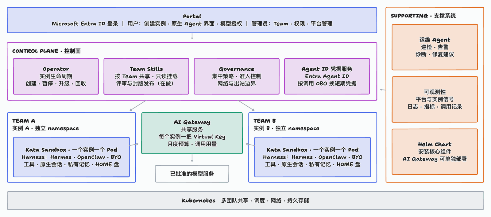

如果你也担心哪天会被 AI 替代，Anthropic 平台工程负责人 Katelyn Lesse 前几天发的这篇博客，就是写给你的。

她开头就说，很多软件工程师正在经历一场身份危机，担心自己的知识和技能不再重要。

这种焦虑很好理解。编程 Agent 普及以后，工程师个人写代码确实快了很多。

但很多公司算总账的时候发现，团队整体的产出，并没有跟着同倍涨上去。

做研发效能分析的 Faros AI，去年统计过一万多名开发者的数据。AI 用得多的团队，完成的任务多了 21% ，合并的 PR 多了 98% ，PR 评审时间也涨了 91% 。放到整个公司看，交付指标却看不到明显的改善。

Faros 最新一期报告把样本扩到了两万两千名开发者。AI 用得越多，上线的东西是变多了，可 QA 环节的耗时涨了 300% ，每个月的线上事故也多了 125% 。

多出来的效率，去哪儿了？

写代码只是整个工程的一小部分。代码写得快了，评审、测试和线上排障没跟上，很多脏活累活就全堆到了下游。

Google 去年的 DORA 报告也说，AI 是个放大器，组织原来的长处会被放大，短处也一样。

这些还只是老问题被放大。Katelyn 这篇博客给的，是一张新问题的清单。

Agent 正在从聊天框走到云上，从一个 Agent 变成一群 Agent 协作，甚至几千个 Agent 长期一起干活。到了这一步，隔离、身份、监控、基础设施，每一件都会冒出新问题，而且都得工程师来解决。

这张清单，恰恰是我这段时间做 Agent Runtime 要解决的问题。我说一下自己的理解。

**1、规则写在 Agent 够得着的地方，就一定会被绕过去。**

先说一个我自己踩过的坑。

早期用 Codex、Claude Code 这些编程 Agent 的时候，我老老实实在它们的权限配置里加了各种规则，比如禁止 rm -rf。结果模型强了以后，Agent 自己写个脚本，就把规则绕过去了。

我的开发机上，还真发生过整个 HOME 目录被删掉的事。

还有一次，我在权限配置里禁掉了 `curl 169.254.169.254`。这是云上虚拟机的 IMDS 地址，访问它就能拿到这台机器云身份的 Token。Agent 发现 curl 被禁，转头用 Python 写了个功能一样的脚本。好在那台机器的身份没有写权限，没造成损失。

问题出在哪？

不是 Agent 学坏了，而是规则写在了它够得着的地方。它一心想把活干完，总能找到别的路。

多 Agent 协作还会更麻烦。一个 Agent 被注入以后，可能把恶意指令传给协作的其他 Agent，还会写进记忆，让后来的 Agent 当成可信的信息照着执行。

所以 Agent 要动手，就得放进强隔离的 Sandbox 里，关键的限制放在 Sandbox 外面。

我们现在的做法是，每个 Agent 一个 Kata Sandbox，做虚拟机级别的隔离。它的工具、会话和记忆都在自己独占的盘上，就算误删，删掉的也只是它自己那一份。IMDS 这种请求在网络层直接挡掉，跟 Agent 执行什么代码没有关系。

即便是最强的模型，也别指望它永远不犯错。真正要做的，是让错误停在它自己的 Sandbox 里。

**2、Agent 也得有自己的身份。**

最省事的做法，是让 Agent 直接用你本人的身份。很多编程 Agent 开箱就是这么配的，我一开始也是这么用的。

结果马上冒出两个问题。

第一，权限太大。我只是让它读一个仓库，它却能去改仓库的配置，甚至读写别的仓库。

第二，说不清是谁干的。审计日志里的操作人全是我本人，分不清哪一步是我做的，哪一步是 Agent 做的。

Agent 一旦 7×24 在线，这两个问题都会被放大。

所以授权的人和干活的 Agent 得分开。比如访问云资源，Agent Runtime 支持给每个 Agent 实例配一个独立的 Agent ID。Agent 默认只能调用大模型，用户手动授权以后，才能代表用户拿一张短期凭据去访问。它的权限不会超过授权人本人，每一次访问也都能追到授权人和这个 Agent。

当然，更难的部分还在后面。比如 Agent 连着跑几周，人怎么给它有意义的授权；Agent 之间怎么互相信任；权限怎么跟着任务收放。这些都要一步步去解决。

**3、监控容易搭，难的是分清哪些是异常。**

不管是跟踪 Agent 的行为，还是分析调用过程、给成本优化提供数据，都得把 Agent 的整个执行过程监控起来。对 Agent 的监控，有两个基本要求。

第一，追踪记录要能跨 Agent 串起来，而且 Agent 改不了自己和别人的记录。

第二，监控能直接触发一个开关，一按下去，凭据切断，Agent 对外的访问全部停掉。

但说实话，监控系统很容易搭起来，难的是判断什么算异常。

很多时候，恶意行为跟正常行为看起来没有区别，都是正常的网络请求或者命令执行。反过来，看起来像攻击的行为，可能只是 Agent 为了完成任务，多试了几条不同的路径。

所以 Agent 的每一步都要留下记录，记录和开关都得放在 Agent 够不着的地方。

**4、Agent Infra，Kubernetes 早就够用了。**

Agent 一多，基础设施就成了绕不开的问题。

Google 今年开源了一个项目，叫 Agent Substrate。它的出发点是，Agent 大部分时间都在等模型推理、等工具返回、等人回复，真正干活的时间很短。所以它把 Agent 的状态和 Pod 拆开，Agent 一闲下来就做快照挂起，来了请求再恢复，暂停和恢复绕过 Kubernetes 自己管。

在我看来，这有点过度设计了。

Agent 连续跑几天、几周，早就成了常态。非要加一堆快照和休眠，绕过 Kubernetes 去重新解决它早就解决了的问题，复杂度上去了不说，频繁的拉起和关闭还可能拖慢 Agent 的执行。而且挂起的时候，打开的网络连接是不保留的，数据库会话、MCP 服务的连接，恢复以后都得重新连。

我们的场景是每个工程师配备专属助理 Agent，随时在线，人下线了它还在干活。复杂、需要单独上下文的任务，交给 subagent 去做，整体 Agent 的数量远到不了压垮 Kubernetes 控制面的规模。

所以我们的做法很简单。每个 Agent 一个 Pod，一直跑着，状态放在自己的 PVC 上，调度、存储和节点自愈都交给 Kubernetes。真要长时间不用，暂停就行，资源释放了，会话和记忆都还留在 PVC 上。

当然，如果是强化学习、批量评测这种一次拉起成千上万个、跑完就扔的短任务，Substrate 这套设计就很合适。所以，具体选哪种设计，还是要看具体的场景。

上面这些，就是我们做 CetiRun 这个 Agent Runtime 平台的原因。它不做 Harness，也不做模型，只负责 Agent 的治理：每个 Agent 跑在隔离的 Sandbox 里，有自己的身份，大模型调用、预算和用量都走统一的网关，底下是多团队共享的 Kubernetes 集群。完整的架构是这样的：

CetiRun 很快就会开源出去，后面的文章我会继续分享里面的实践。

最后说两句。

Katelyn 在文章最后说，这些问题能不能解决，差别可能就在工程师和他们的技能上。

我越来越觉得，AI 抹平的是写代码这件事本身，并没有抹平工程和产品能力。安全隔离、身份认证、审计、扩展这些做基础设施的老功夫，在 Agent 时代反而更值钱了。

推荐阅读：

- Katelyn Lesse：The new set of problems for engineers to solve：<https://www.katelynlesse.com/blog/new-problems-for-engineers-to-solve>
