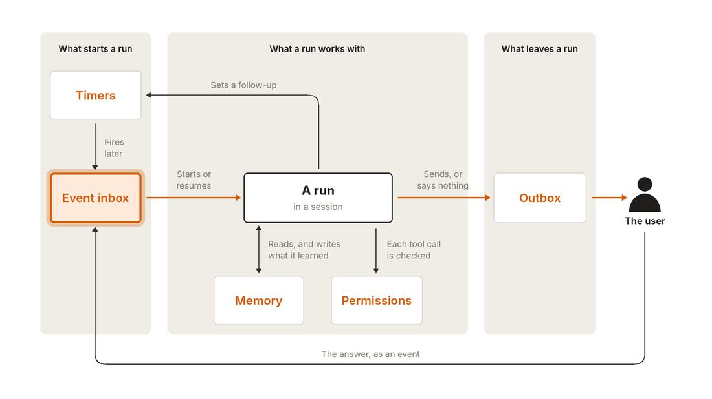
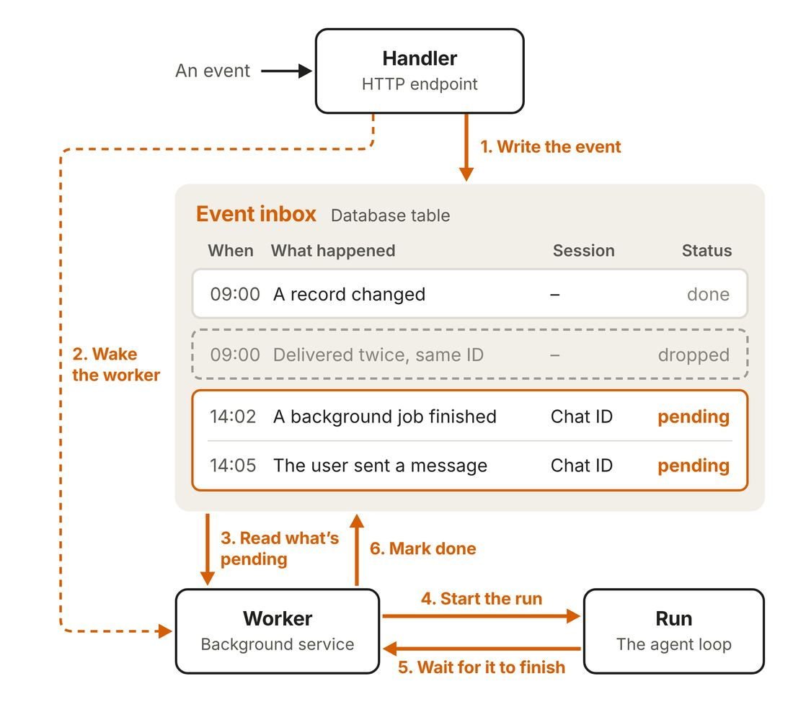
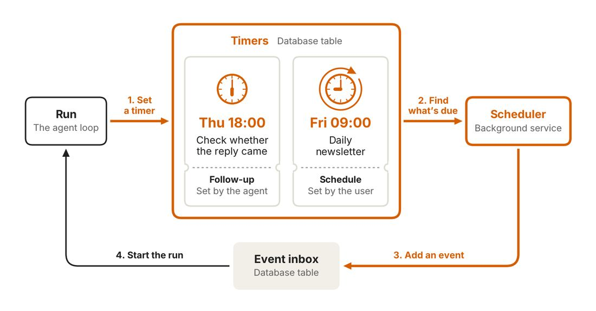
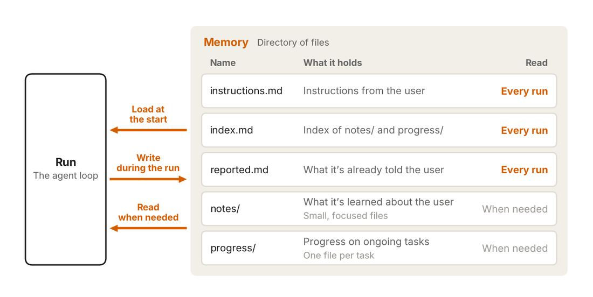
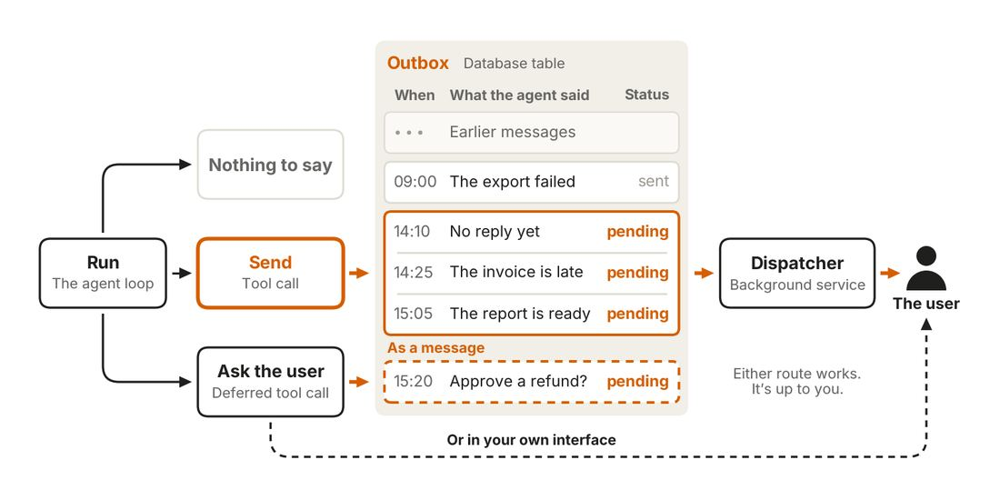

想把一个聊天 Agent 改成 7×24 后台干活的工作伙伴，难的地方不在大模型，也不在 Agent Harness，而在推理循环之外的那套管理事件调度、状态延续和权限边界的外围系统。

很多人第一次搭常驻 Agent，直觉做法就是起一个长对话，再加个定时脚本每隔几分钟叫醒模型看一眼。我自己在玩 OpenClaw、Hermes Agent 以及 Codex、Claude Code 这些编程 Agent 的时候就发现：这种做法跑短时 Demo 没问题，真挂在后台跑几天，不是并发冲突把状态覆盖掉，就是上下文和记忆越攒越多，导致模型幻觉，甚至都会忘记一开始给它设定的任务目标。

这两天 Anthropic 平台团队的 William Hu 发了一篇官方指南《Building always-on agents》，正好把搭好常驻 Agent 需要的五个核心原语列成了一份架构清单。一方面，新模型的判断力变强了，更清楚什么时候该自己推进、什么时候该停下来问人；另一方面，在一个长程编程基准测试里，Opus 5.5 每解决一个任务的成本比 Opus 5 降了 78% 。模型成本大幅降低了，后台常驻才有了大规模落地的条件。

所谓的常驻在线，只是给用户的感受。实际上，Agent 底下的推理循环跟普通聊天模式没有区别，绝大部分时间都处于零 Token 消耗的休眠态，只有事件来了才醒来跑一小段执行，在会话里完成工具调用、关键信息存储、通知结果，接着继续休眠，也就是一套标准的事件驱动异步架构。

这份清单里的事件收件箱、定时器、记忆、权限和发件箱这五个组件看起来很简单，但落到 Agent 上有不少容易漏掉的细节。结合之前体验过的 Agent 产品，我说一下自己的理解。

**1、事件收件箱，外部事件不能直接调 Agent。**

普通聊天 Agent 只有在用户发消息时才会运行，而常驻 Agent 的触发来源要多得多：Webhook 回调、定时任务、后台作业，还有用户的回复，随时都可能到达。

最容易踩的坑，就是让这些事件源直接去调 Agent。两个事件同时到达，就会拉起两个并发执行互相覆盖状态；要是跑到一半进程挂了，这个事件也就直接丢了。

所以在所有事件源前面，都需要先加一层事件收件箱。它的结构并不复杂：一张持久化的数据库表（或者消息队列）存事件列表，一个轻量 HTTP 接口负责接收写入，后面配一个后台 Worker 从表/队列里拉取待处理事件，并按事件源的唯一 ID 做去重。用户回复这类延续前文的消息，就恢复原来的会话；全新的外部事件，就新开一个会话。

架构看着简单，但实现上有四个细节要注意：

第一，接收接口只做轻量校验，写入成功就立刻返回确认。很多 Webhook 服务商把慢响应直接当成失败处理，像防提示词注入这类耗时检查，应该留到后面的执行阶段再做。

第二，以收件箱的数据表作为唯一事实源。Worker 被唤醒后先去表里拉取最新的待处理事件，这样就算执行中途崩溃，新拉起的 Worker 也能拿到同一条未完成的事件继续重试。

第三，同一个收件箱同一时刻只允许一个活跃 Worker。起步阶段可以按每个用户一个收件箱来建，单 Worker 串行消费，从根源上避免并发写坏状态。如果执行中途又来了新事件，可以按策略排到下一轮、并入当前轮，或者打断重跑。

第四，把连续到达的待处理事件合并成一次执行。比如用户连续发了几条消息，Worker 拉取时直接合并交给同一轮推理，Agent 只需要回复一次，既省 Token 也不会频繁打扰用户。

之前分析 Grok Bot 的时候我发现，它的设计也是同样的思路。不管是定时任务到点、其他 Bot 发来消息、Slack 进了新通知，还是用户在卡片上点了授权，最后都会加上 `[SAND_HIDDEN_PROMPT]` 来源标记，统一放进同一条对话流里按顺序处理。反过来，Grok Bot 的多 Bot 私聊因为没有轮数上限，几个 Bot 互相发消息唤醒、反复互审，很快就能把一周的额度烧光。所以统一入口只管得了顺序和去重，Agent 之间互相唤醒还得有硬性的轮数上限，只靠提示词，模型可以不听。

**2、定时器，主动干活不用让模型一直醒着。**

常驻 Agent 能主动推进任务，靠的是一张独立的定时器表，把下一次该醒的时间记下来。

定时器一般分成两类。一类是跟进提醒，由 Agent 在执行任务时给自己设定截止时间，比如等待外部回复时定时回来检查进展，触发一次就标记为完成；另一类是周期任务，按固定频率重复执行，比如每天早上的信息汇总，触发后自动把到期时间更新到下一个周期。

定时器表要和事件收件箱分开存储，收件箱只存放当前已经就绪、可以立即处理的事件。定时器到期后，由后台调度服务或持久化执行引擎定期扫描到期记录，更新定时器状态后，往收件箱写入一条新事件并唤醒 Worker。

为什么要先写入收件箱，而不是直接启动 Agent？

因为定时任务到期的同一时刻，用户可能刚好也在发消息，Webhook 也可能刚好触发。统一写入收件箱之后，前面做好的单 Worker 串行消费和去重机制就能直接复用，不需要维护两套并发控制逻辑。

Meta Muse 的定时机制也是这么处理的。它的目标页本身不运行任务，实际执行靠的是挂在目标下面的定时任务；遇到需要高频监控状态的场景，它不会每分钟唤醒一次大模型消耗 Token，而是先用普通脚本在外部轮询，检测到状态变化之后再发事件唤醒模型。

**3、记忆系统，只存没法从别处查到的信息。**

常驻 Agent 要跨多次独立执行保持上下文连贯，靠的是独立持久化的记忆系统。做记忆系统常见的问题不是记不住，而是什么都往里塞。

我之前用 OpenClaw 时就碰到过这个问题。它的后台记忆整理机制很容易把对话里琐碎的细节也晋升上来，对话一多，`MEMORY.md` 就会越来越臃肿，每次启动都要占用不少上下文空间，最后只能定期手动清理。当时我的做法是给每个项目单独建一个目录，主 `MEMORY.md` 里只放索引，跟后面 Anthropic 给的思路一样。

Anthropic 给出的原则是，记忆里只存无法从其他系统重新查到的信息。如果某项内容本来就在 Issue 跟踪系统或代码仓库里，记忆中只保留一个引用指针就够了，不需要把原始内容复制一份。

在具体实现上，可以把记忆映射成数据库或对象存储支持的文件目录，保证 Worker 重建后记忆仍然保留。按加载时机来看，每次执行启动都必须加载的有两份：一份是用户指令，因为常驻场景下人不在旁边随时纠偏，行为约束每轮都需要加载；另一份是已发消息记录，记录已经向用户汇报过的内容，避免在不同轮次里重复发送。

容易随时间增长的是另外两类：记录用户角色、偏好和历史纠正的用户笔记，以及每个长任务单独建一份、记录已完成和待办事项的任务进度。这两块内容变多以后就拆成多个小文件，每次启动只加载一份目录索引，执行中需要哪部分细节再去读取对应的文件。

在这四类运行期写入的记忆之上，还可以加一层离线的 Dreaming 整理机制，定期回顾历史会话、替换过期条目，提炼单次执行看不出来的长期模式。OpenClaw 的 Dreaming 也是这类机制，区别在于这里的整理要能替换过期条目，只往上晋升的话，记忆迟早还会臃肿。

上下文窗口的固定开销也需要严格控制。系统提示词、工具定义和每轮必读的记忆文件每次执行都会加载，体积要尽量精简，再配合前缀缓存降低重复加载的成本。当会话过长需要压缩历史消息或重开新会话时，上下文细节不可避免会丢失，因此需要跨轮保留的信息要在执行过程中及时写入记忆文件，不能只依赖会话历史。

**4、权限控制，凭据外置和异步审批缺一不可。**

常驻 Agent 持有用户的访问权限，又在无人值守的状态下自动运行，权限控制是整套架构里风险最高的一环。这里既不能把明文密钥直接放进 Agent 的运行环境，也不能一遇到敏感操作就把后台 Worker 阻塞住等待人工确认。

William 给出的解法是把现有的三个权限组件组合起来使用：

第一，凭据存储与外部代理。常驻 Agent 访问外部系统少不了密码或 API Token，推荐的模式是在 Agent 运行环境外面加一层代理网关。Agent 发出的请求本身不带凭据，由外部代理在转发请求时把真实凭据注入进去，这样 Agent 始终接触不到明文密钥。

第二，Auto mode 自动审查。后台运行不可能每次调用工具都找人审批，可以先像 Claude Code 的 Auto mode 那样，用分类器自动审查高风险动作，把识别出危险的操作拦截下来，让模型改用更安全的路径，只把关键决策留给人工审核。

第三，延迟工具调用。当某个操作确实需要用户补充信息或确认授权时，先把当前会话在工具调用中途保存下来，直接结束本次执行，同时通过交互卡片（比如基于 MCP Apps 构建的卡片）把审批请求发送给用户。等待用户回复期间，Worker 不会被阻塞，可以继续处理收件箱里的其他事件；等用户在卡片上完成确认，结果会作为一条新事件写回收件箱，触发新的执行并恢复之前保存的会话继续运行。

Meta Muse 里的 Sentinel 服务就是典型的外部权限网关。它把凭据和对外网络出口都放在容器外的独立安全域里，Agent 可以使用凭据但始终看不到明文；需要用户授权时，审批卡片直接推送到手机 App 上，不经过聊天会话，Agent 既看不到审批卡，也无法代替用户点击同意。即便模型受到外部网页的提示词注入影响，也绕不过容器外的这层拦截。

**5、发件箱，后台 Agent 不能每跑一轮都发消息。**

普通聊天 Agent 是边推理边向界面流式输出内容，用户可以跟着看它调用工具和生成回答的过程。常驻 Agent 的工作大部分在后台完成，用户通常只需要拿到最终结果和少量关键信息。

所以在常驻架构里，一次后台执行结束时只有三种出口：向发件箱写入一条结果消息、发起延迟工具调用请求用户输入，或者判断没有必要通知用户，直接静默结束。

如果场景简单，给 Agent 配一个直接发送消息的 `send` 工具就够用了；只有在需要控制推送节奏或处理发送失败重试时，才需要单独建一张发件箱数据表，配合后台分发服务按策略投递。

相比发件箱的表结构，更需要调优的是消息发送频率。发得太多容易变成噪音，发得太少又可能漏掉用户需要关注的信息。Anthropic 的建议是通过构建评测集来寻找平衡点；实际落地时，更稳妥的做法是让 Agent 一开始尽量少发消息，随着运行稳定再逐步增加主动推送。

这一点在 Meta Muse 上也能看到一致的设计取舍。它的后台每小时都有流程在整理记忆、扫描信息，但主动推送的次数非常克制：非紧急事项要等用户醒着且空闲时才推送，每天最多一条；每条消息发出前还要经过分类器和撰写器两道筛选，提示词里明确要求，没有值得告知的内容就一条都不发。

**6、常驻 Agent 架构清单，搭之前可以按这张表逐项核对。**

如果你正准备把现有的 Agent 改成后台常驻，或者从零搭一套类似的系统，可以把上面这五个组件的职责和实现要点对照检查一遍：

| 外围组件 | 解决的典型问题 | 核心实现要点 |
| --- | --- | --- |
| 事件收件箱 | 并发执行覆盖状态、进程崩溃丢失事件 | 接口快速落表返回确认，单收件箱单活跃 Worker 串行消费，连续消息合并执行 |
| 定时器 | 死循环高频轮询消耗 Token | 区分单次跟进提醒与固定周期任务，到期统一写入收件箱触发 |
| 记忆系统 | 跨轮次丢失上下文、记忆文件持续膨胀 | 只存无法从外部查到的信息，笔记与进度启动只读目录索引，配合离线整理清旧项 |
| 权限控制 | 明文密钥泄露、等待人工审批阻塞后台 | 外部代理注入凭据，分类器拦截高危操作，需人工审批时保存会话结束本次执行并释放 Worker |
| 发件箱 | 后台频繁推送消息变成噪音 | 允许执行静默结束，用评测调优发送频率，初期保持低频推送再逐步放开 |

当然，Anthropic 这份指南解决的主要是单个常驻 Agent 在应用层的闭环。如果真要放到团队或企业的多租户生产环境里大规模运行，在这五个组件底下，还需要补上虚拟机级别的强隔离 Sandbox、独立的 Agent 身份认证以及跨 Agent 的审计熔断机制，把安全底线放在 Agent 自己接触不到的基础设施层。

我越来越觉得，随着大模型长程任务的成本大幅降低，做常驻 Agent 拉开差距的地方已经不在提示词和 Agent Harness 本身，而在推理循环之外的那套管理事件调度、状态延续和权限边界的系统工程能力。

**推荐阅读：**

- Building always-on agents：<https://claude.com/resources/articles/building-always-on-agents>
