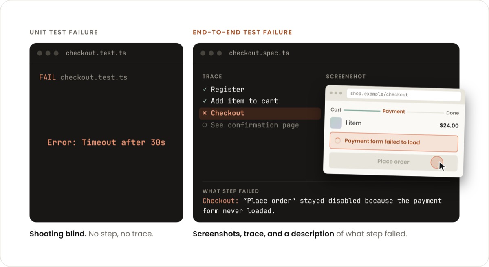

现在用 AI 写代码，只要模型足够强，给 Agent 的目标足够清楚，用什么样的编程工具和 Agent Harness 其实都已经差不多了，大体上都能跑出一个不错的结果。

不过，想要保证 Agent 产出的质量和可靠性，最重要的一块是给它真实环境和真实功能的验证。我在日常开发里，现在每一个功能的开发都不再去做手工验证了，而是把验证步骤一步步列清楚，让 Agent 照着步骤去执行，包括跑完整的端到端测试。比如在做 Agent Runtime 项目的时候，我会直接让 Agent 调用 `kubectl` 和后端 API，再配合 Chrome MCP 操作页面，把整个新功能端到端跑通。

这两天 Anthropic 工程师 Addy Osmani 发了一篇博客《How the Claude Code team thinks about verification》，正好把 AI 编程最核心的验证问题讲得很清楚。在 Claude Code 团队内部，大约 90% 的代码都由 Claude 编写和审查。没有自动验证的时候，一个人同一时间顶多盯一两个 Agent；把验证闭环搭起来之后，才能同时并行跑几十个甚至上百个 Agent。在他们针对结构化文件生成的内部测试里，加一个独立的评分器对照标准检查产出，任务成功率比普通提示词循环提高了最多 10 个百分点，而且问题越难提升越明显。

虽然 Claude 封号严重，但不得不说，他们的工程博客质量真的很高，所以很推荐做 AI 编程的朋友读一读这篇原文。结合我自己的日常实践，下面也说一下我的理解。

**1、端到端验证，把整个应用跑起来比写单元测试管用得多。**

如果只能选一种测试投入精力，优先选端到端测试，核心是让 Agent 把改动后的应用实际跑起来。

很多人用 Claude Code 或 Codex 写完代码，看单元测试全绿就觉得没问题了。但单元测试虽然跑得快、结果稳定，却经常出现测试全过、功能照样坏掉的情况。为什么会这样？因为写代码的 Agent 和单元测试都只看到了局部逻辑，并不理解完整的业务任务。

更头疼的是报错信息。单元测试失败时，往往只抛出一句 `Error: Timeout after 30s`，没有执行步骤也没有现场痕迹，排查起来只能靠猜。而端到端测试描述的是注册、加购物车、结账、跳转确认页这样的真实用户流程，整个功能要么跑通、要么失败，很难糊弄过去；一旦挂掉，还能直接给出步骤轨迹、页面截图和具体的失败原因，比如结账按钮一直灰着点不了，是因为支付表单压根没有加载出来。

想让端到端测试发挥作用，就得给 Agent 配上操作和观察真实运行系统的手和眼。Addy 在文章里列了几类常用工具：

- 前端网页改动用 Claude Chrome 扩展或基于 CDP 的浏览器工具
- 移动端用 iOS 或 Android 模拟器的 MCP
- 桌面应用用 Computer Use，后端开发就在本地把服务拉起来测
- 同时还可以维护一份从用户视角编写的功能地图，写清访问路径、快捷键、页面选择器和预期结果，既当 Agent 的操作指南，也当验收打分的标准。

我自己在开发 Agent 项目时也是这么做的。每次做完一个新功能，不再自己开浏览器点一遍，而是把验证步骤按顺序写清楚交给 Agent：构建，部署，检查集群里的工作负载和配置是否就绪，模拟工作负载，调用后端 API 校验，最后配合 Chrome MCP 打开页面走完整个交互流程，顺带同时盯着控制台和日志看看有没有报错。

Claude Code 团队的做法是把启动运行环境和跑冒烟测试的步骤，统一写成仓库 `.claude/skills/` 目录下的 `verify` Skill，尽量放在离对应代码最近的位置，需要多少个就建多少个。Claude Code 在提交代码前知道先去调用 `verify` Skill 做端到端验证。他们还会专门让 Claude 反复打磨和压测这个 Skill，把它做得又快又稳。因为一旦测试变慢，Agent 分批跑测试的频次就会降下来，出了问题反而更难定位；至于比较重的测试，放在正式提交改动之前跑最合适。

**2、属性测试和差分测试，专门补 Agent 自己想不到的边界情况。**

端到端测试能守住主干流程，但常规测试都有一个局限：它们测的只是写代码的人预先想到的异常情况。

如果业务代码和测试代码都是同一个 Agent 写的，两边就会带着同样的思维盲区，人容易漏掉的边界条件，Agent 照样会漏。以前写全套测试、基准和规范对工程师来说成本很高，现在让 Agent 生成这些东西非常快；而且测试一旦生成出来，就是作为普通软件反复运行，高频执行也几乎不消耗额外的 Token。所以除了端到端测试，还有两类测试很值得让 Agent 补上。

第一，属性测试。

你不需要一条条编造输入用例，而是先写下一条在系统里绝对不能违反的约束，再交给属性测试库（比如 JS/TS 的 `fast-check`、Python 的 `Hypothesis`、Rust 的 `proptest`）自动生成几千组随机输入去尝试证伪。

几乎每个软件项目里都能找到这类约束：

- 往返一致：比如编解码、解析和序列化，把数据编码再解码回来必须等于原值
- 业务不变量：系统里始终成立的硬性条件，比如账户余额永远不能变成负数
- 幂等性：迁移、归一化或重试动作执行两次，和执行一次的效果一样
- 等价性：性能优化后的代码，和朴素但正确的实现输出结果一致

因为这些边界输入不是写代码的那个 Agent 编出来的，在做老系统重写、原有文档早已偏离线上真实行为时尤其管用。

第二，差分测试。

在做大规模系统迁移或重构、要求新旧系统功能保持一致的场景下，老系统本身就是现成的标准答案。做法是拿随机生成的输入或者采样的真实线上流量，同时喂给老系统和新系统，对比两边的输出结果。只要输出对不上，就说明引入了新 bug 或者破坏性变更。落地时只需要注意抹掉空白字符这类无关差异，再维护一份新旧环境允许存在差异的已知变更白名单。

**3、验证门控，不能让代码改动去修改审它的检查规则。**

有了测试和验证步骤还不够，还得保证验证器本身不被糊弄。

我之前做 AI 代码审查和 Agent 安全隔离时就发现，只要限制和检查规则放在 Agent 自己够得着的地方，它为了把任务顺利交差，很容易自己找路绕过去，比如顺手把报错的测试断言改掉、往测试里塞 `sleep` 硬等，甚至在同一个 PR 里把审查标准改松。如果一次代码改动能够修改评判它自己的检查规则，这道检查就失效了。

那怎么保证验证环节不被 Agent 糊弄过去？Claude Code 团队有三条可以直接借鉴的工程规矩：

第一，检查规则与被审代码隔离。

他们不会靠堆叠多个昂贵的审查器来提高质量，而是集中调好一个主审查器，用 `REVIEW.md` 写明这部分代码需要重点关注什么，并让每一轮审查和验证都承接上一轮的上下文与历史失败记录，而不是每次从头重查。

这里最关键的一条边界是：代码审查只从基础分支或默认分支读取 `REVIEW.md` 等门控规则，绝不读取当前 PR 改动里的版本。同时，打开 PR 之前必须先在本地通过 Hook 或 `/goal` 跑过测试、构建和 Lint 这些低成本检查，避免把本地就能抓到的低级问题推上去占用共享的审查和 CI 时间；审查也严格绑定具体的 commit，审查过程中只要有人新推了代码，旧的审查结果就直接作废。

第二，修 3 轮还不过就停下来找人，对不稳定测试零容忍。

没人能逐行读完所有改动，测试失败就是决定哪些地方需要人工介入的信号。Claude 会先跑检查并尝试修复失败项；如果连续修 3 轮还是挂，就立刻停下来拉人介入。每个模块的检查项由对应的代码负责人自己编写和打磨，拉人审查时必须直接写明原因，不用审查者自己去翻 diff 猜。

碰到时好时坏的不稳定测试也是同样的处理原则。放任不稳定测试存在，等于训练 Agent 遇到报错就重跑碰运气，而不是去修代码。所以他们严禁 Claude 跳过测试、加 `sleep` 或者无限重试直到通过；实在找不到根因，就直接删掉这个测试并写明原因。

第三，新门控先开观察模式，强制拦截留好防死锁出口。

他们在内部仓库会给每个 commit 打上验证方式标记，连没做验证的提交也会标上 `none` 方便检索。同时他们做了一道检查当前会话是否包含 `/code-review` 或 `/verify` 的提交门控，分关闭、观察和强制三种模式。

新门控上线先开观察模式，只记录哪些提交会被拦下，排查完误报再切到强制拦截模式。强制模式下，任何提交都可以在 commit message 里说明未做验证的原因；而且考虑到 Claude Code 也不是完美无缺的，如果同一个会话里提交连续被拦了两次，下一次提交就会放行，防止把 Agent 彻底卡死。

**4、规则演进，把漏掉的问题沉淀下来还要定期清理。**

验证体系搭起来之后，线上漏掉的问题要能回流成新规则，过时的规则也得定期清理。

第一，按代码 diff 按需触发历史故障检查。

靠人去背历史事故清单是不现实的，每次全量检查又太慢。Claude Code 团队维护了一份包含 39 个条目的可靠性检查清单，每一条都写清了可以从 diff 里识别的触发条件、具体检查项，以及对应的历史事故或 PR。比如其中一条是检查 `--resume` 能否加载旧会话记录：当 diff 修改了会话存储或消息结构时，就会自动触发检查新增字段能不能兼容没有这个字段的老记录。Claude 读完 diff 后只检查匹配触发条件的条目，每次通常只有 3 到 10 条，既防住了老问题复发，也不会拖慢节奏。

第二，只把重复出现的问题变成规则。

如果 Agent 反复在某类检查上栽跟头，比如日志里不小心打出用户数据，就可以加一个 Hook 或在 `CLAUDE.md`、`REVIEW.md` 里补一条更明确的规则堵住。在 Claude Code 仓库里，从人工审查评论和回滚 PR 里提炼规则有一个门槛：同类问题必须在至少两个 PR 里出现过，并且能直接从 diff 上看出来。另外，审查结果还会区分必改问题、细节改进和历史遗留问题，标了历史遗留问题的老 bug 不会算在当前改动的作者头上。

第三，定期清理测试、验证步骤和规则文档。

这一点我自己维护 `CLAUDE.md` 和 `AGENTS.md` 时也很有感触：不管是测试套件、验证步骤还是 `.md` 规则文件，只要不管就只会越长越长。文档一臃肿，模型容易漏掉关键约束；测试一膨胀，单次验证的耗时就会拖长。Claude Code 团队把清理测试和 `.md` 文件当成例行维护工作来做，删掉过时冗余的条目，只保留值得继续运行的检查。

**5、AI 编程验证落地清单，日常开发可以按这张表逐项对照。**

如果你想把手头项目里的手工验证替换掉，让 Claude Code 或 Codex 产出的代码质量更稳，可以按下面这五个环节逐项对照：

| 验证环节 | 容易踩的坑 | 落地做法 |
| --- | --- | --- |
| 端到端冒烟验证 | 单元测试全绿但完整功能坏掉，报错缺少上下文 | 给 Agent 配浏览器 MCP、`kubectl` 或本地服务环境，把启动与核心链路检查写成 `.claude/skills/verify` |
| 边界与重构测试 | 同一个 Agent 写代码和写测试，共享相同的思维盲区 | 用属性测试库随机生成输入校验核心不变量；大规模迁移时拿老系统做差分测试比对输出 |
| 检查规则隔离 | Agent 为求通过顺手改松审查标准，或未自测就提 PR | 只从基础分支读取 `REVIEW.md`，本地用 Hook 或 `/goal` 先跑测试与 Lint，审查绑定具体 commit |
| 失败处理与门控 | 不稳定测试把 Agent 训成盲目重试，硬门控卡死会话 | 连续修 3 轮不过停下找人；严禁对不稳定测试加 `sleep` 或重试；新门控先开观察模式并留放行出口 |
| 历史故障回流与瘦身 | 历史事故反复出现，规则与测试只增不减越来越慢 | 维护按 diff 触发的检查清单，问题至少出现两次再进规则，定期清理过时的测试与 `.md` 文件 |

把验证层当成一个独立的工程系统来维护之后，开发者的工作重心也就跟着变了：你不再需要逐行读完每一处 diff、手工去点每一个页面，而是把精力放在定义清楚什么叫做完，以及审查 Agent 跑出来的运行证据上。

推荐阅读：

- How the Claude Code team thinks about verification：<https://claude.dev/blog/how-the-claude-code-team-thinks-about-verification/>
